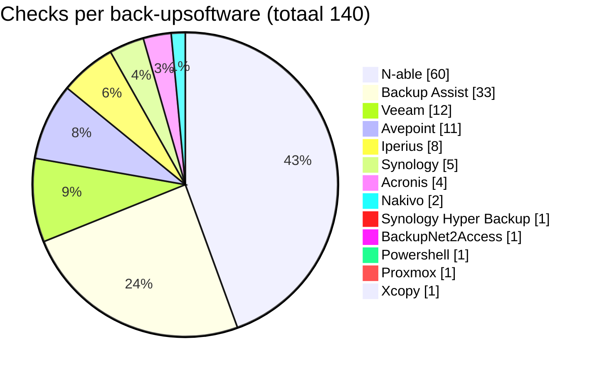
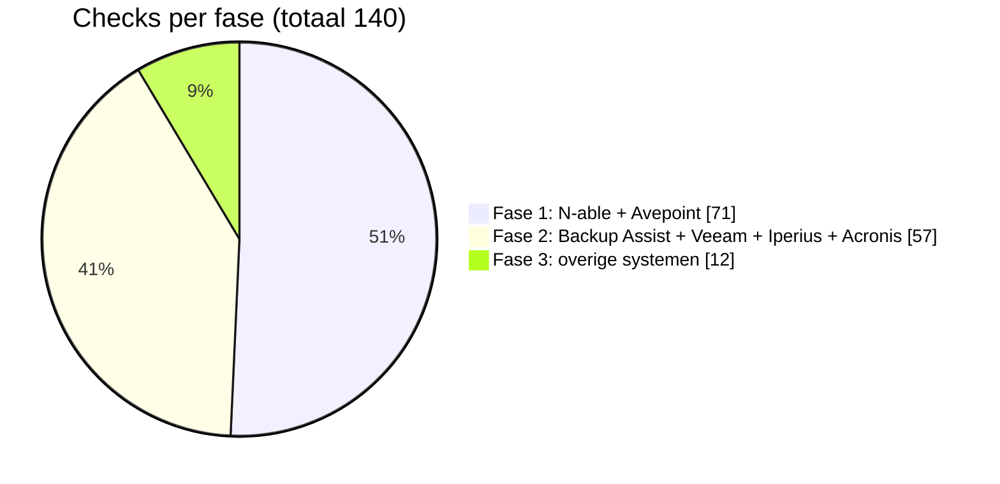

# Data

# CheckCentral graduaatsproef: overzicht back-ups

> Aanpassen? Wijzig gewoon het getal achter de dubbele punt. GitHub tekent de grafiek automatisch opnieuw.

## 1. Aantal checks per back-upsoftware

Klanten onder betaald back-upcontract, met de hand geteld (totaal: 140).

## 2. Fasering: eerst de makkelijke checks

Logica: begin met de grootste groepen met één uniform mailformaat. Zo is er snel veel gedekt. Eindig met de uitzonderingen die mogelijk geen standaardmail sturen.

| Fase | Software | Checks | Waarom |
| --- | --- | --- | --- |
| 1 | N-able, Avepoint | 71 | Groot volume, uniform mailformaat. Eén rule dekt veel checks |
| 2 | Backup Assist, Veeam, Iperius, Acronis | 57 | Vaste mailstructuur, maar meer variatie per klant |
| 3 | Synology, Nakivo, Hyper Backup, BackupNet2Access, Powershell, Proxmox, Xcopy | 12 | Weinig checks per systeem en mogelijk geen standaardmail. Hier is het meeste testwerk |

## 3. Prijs op CheckCentral

| Scenario | Checks | Per maand | Per maand bij jaarbetaling (-10%) |
| --- | --- | --- | --- |
| Huidig aantal | 140 | 70 USD | 63 USD |
| Met buffer | 280 | 140 USD | 126 USD |

- Standaardcheck: 0,50 USD per check per maand.
- Kwantumkorting begint pas vanaf 400 checks, dus geen korting in beide scenario's.
- Betalingskorting: 5% bij kwartaalbetaling, 10% bij jaarbetaling.
- Prijzen exclusief btw.
