# 2. Plan van aanpak

> Weging: 5% · Deadline: **1 november 2026**

## 2.1 Fasen, deliverables en mijlpalen

| # | Fase | Activiteiten | Deliverable | Timing | Betrokkenen |
|---|---|---|---|---|---|
| 1 | Projectvoorstel | Probleemanalyse, scope, kosten- en GDPR-analyse | Projectvoorstel (PDF) | Wk 1–3 | PXL-coach, werkplekcoach |
| 2 | Plan van aanpak | Fasen, deliverables, Gantt, planning | Plan van aanpak | Wk 4–6 (**1 nov 2026**) | PXL-coach |
| 3 | Onderzoek/analyse | Inventaris ~125 jobs, mailformaten per leverancier | Overzicht databronnen & mailstructuren | Wk 7–8 | Support, werkplekcoach |
| 4 | Ontwerp/uitwerking | CheckCentral inrichten, matching rules per leverancier | Ingerichte testomgeving | Wk 9–10 | Werkplekcoach |
| 5 | Realisatie | Alle back-ups koppelen, dead man's switches | Volledig operationeel dashboard | Wk 11–12 | Support |
| 6 | Testen & bijsturen | Success/Warning/Error/Missing simuleren | Testrapport + validatie alerts | Wk 13 | PXL-coach, werkplekcoach |
| 7 | Rapport | Eindrapport, reflecties, STAR | Definitief rapport (**17 jan 2027**) | Wk 14 | PXL-coach |
| 8 | Presentatie | Slides, verdediging, demo/overdracht | Slides + werkplekdemo | Wk 14+ | Jury, collega's |

## 2.2 Gantt (indicatief, wekenummer = projectweek)

```mermaid
gantt
    title Graduaatsproef CheckCentral
    dateFormat  X
    axisFormat  Wk %s
    section Documenten
    Projectvoorstel        :a1, 1, 3
    Plan van aanpak        :a2, 4, 3
    section Uitvoering
    Onderzoek/inventaris   :b1, 7, 2
    Ontwerp                :b2, 9, 2
    Realisatie             :b3, 11, 2
    Testen                 :b4, 13, 1
    section Afronding
    Rapport                :c1, 14, 1
    Presentatie            :c2, 14, 2
```

> Pas aan naar echte kalenderweken zodra de planning met de coach vastligt.

## 2.3 Randvoorwaarden
- Max. **4u/week** op de werkplek, geregistreerd in **OnStage** ("Graduaatsproef").
- Opleverbaar gerealiseerd resultaat (50%): werking, testing, handleiding, overdracht.
- GitHub-repo met verzorgde README, beslissingslog en heldere commit-historie.
- Jury: 15 min presentatie + 10 min vragen (verplicht om te slagen).

## 2.4 Kwaliteitscriteria (Definition of Done)
- [ ] Alle actieve back-upjobs gekoppeld aan een check
- [ ] Elke job heeft correcte matching rule + status-mapping
- [ ] Dead man's switch met tijdvenster per relevante job
- [ ] 4 scenario's (Success/Warning/Error/Missing) getest en gedocumenteerd
- [ ] Handleiding gevalideerd door ≥ 2 support engineers
- [ ] Overdracht uitgevoerd en afgetekend
- [ ] GDPR-conclusie bevestigd door verantwoordelijke binnen Lipa ICT

## 2.5 Risicoregister

| ID | Risico | Kans | Impact | Maatregel |
|---|---|---|---|---|
| R1 | Mailformaat leverancier niet parsebaar | M | H | Vroeg inventariseren, fallback: forward-rule/aangepast onderwerp |
| R2 | GDPR-bezwaar tegen externe verwerking | L–M | H | Vroeg afstemmen, DPA nazien, mailinhoud minimaliseren/filteren |
| R3 | Proefperiode (60d) verloopt vóór afronding | M | M | Proef pas starten bij realisatie-fase; kostenakkoord vooraf |
| R4 | Te veel false positives → alert-moeheid | M | M | Tijdvensters bijstellen met support-feedback |
| R5 | Tijdgebrek (4u/week) | H | M | Weekplanning, prioriteren per leverancier-batch |
| R6 | Klantdata lekt in repo | L | H | `.gitignore`, anonimiseren, review voor commit |

## 2.6 Communicatie
Wekelijks korte update aan werkplekcoach; mijlpaalcontact met PXL-coach. Notities in `logboek/`.

## 2.7 Issues/Milestones op GitHub
Maak één milestone per fase (1–8) en issues per deliverable. Zie `.github/ISSUE_TEMPLATE/`.
