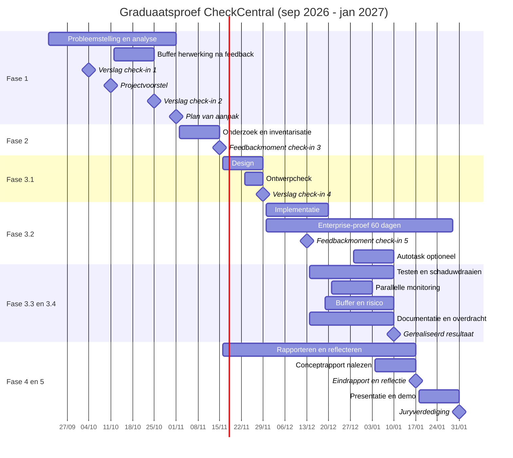

# 2. Plan van aanpak

> Titel: **CheckCentral-back-updashboard**
> Student: Lore Grymonprez · Werkplekcoach: Edwin Vanspauwen · PXL-coach: Klaas Thys
> Werkplek: Lipa ICT · Deadline: **1 november 2026**
>
> De ingediende versie is het PDF-document *Document 2: Plan van aanpak* (Hogeschool PXL, door de werkplekcoach goedgekeurd). Dit bestand is de samenvatting voor de repo en volgt die versie.
> **Geen klantnamen of hostnamen in deze repo.**

## 2.1 Weken (projectweken)

| Week | Datum | Week | Datum |
|---|---|---|---|
| 6 | 26 okt–1 nov | 13 | 14–20 dec |
| 7 | 2–8 nov | 14 | 21–27 dec |
| 8 | 9–15 nov | 15 | 28 dec–3 jan |
| 9 | 16–22 nov | 16 | 4–10 jan |
| 10 | 23–29 nov | 17 | 11–17 jan |
| 11 | 30 nov–6 dec | 18 | 18–24 jan |
| 12 | 7–13 dec | 19 | 25–31 jan |

## 2.2 Fasen volgens de onderzoekscyclus

| Fase | Onderdeel | Periode | Deliverable | Betrokkenen | Onderzoeksmethode |
|---|---|---|---|---|---|
| 1 | Probleemstelling en analyse | t.e.m. wk 6 (1 nov) | Goedgekeurd projectvoorstel, plan van aanpak | PXL-coach, werkplekcoach | Afwegen, inventariseren, literatuurstudie, observatie |
| 2 | Onderzoeksuitvoering: inventaris back-ups, Free tier-account, demo | wk 7–8 (2–15 nov) | Documentatie huidige back-upsituatie, Lipa Support-account, demoverslag | Werkplekcoach, support engineers, CheckCentral-support (extern) | Inventarisatie, literatuurstudie, interview |
| 3.1 | Bouwen: design | wk 9–10 (16–29 nov) | Beknopt ontwerpdocument met flowdiagram, naamgevingsconventies en overzicht tijdsvensters | Werkplekcoach | Vergelijking |
| 3.2 | Bouwen: implementatie (Cove eerst, daarna overige back-ups via e-mail, optioneel Autotask) | wk 11–13 (30 nov–20 dec) | Werkend CheckCentral-dashboard met gekoppelde checks, tijdsvensters en overzicht per klant | Werkplekcoach, support engineers | Observatie |
| 3.3 | Bouwen: testen en schaduwdraaien | wk 13–16 (14 dec–10 jan) | Testrapport en definitieve instellingen | Support engineers, werkplekcoach, PXL-coach | Observatie, vergelijking met huidige controle |
| 3.4 | Bouwen: documentatie en maintenance | wk 13–16 (14 dec–10 jan) | Beheerhandleiding, overdracht, prijsinschatting met abonnementsvoorstel | Support engineers, werkplekcoach | Observatie, interview, vergelijking |
| 4 en 5 | Rapporteren en reflecteren, presentatie | wk 9–17 (rapport t.e.m. 17 jan), presentatie wk 18–19 | Eindrapport (17 jan 2027), reflectieverslag, presentatieslides met demo | PXL-coach, werkplekcoach, jury | Inventarisatie, vergelijking |

### Onderzoeksvragen per fase

- **Fase 2:** welke back-ups, meldingen en functies zijn nodig voor een duidelijk klantoverzicht?
- **Fase 3.1:** hoe richten we de groepering, matchingregels en tijdsvensters correct in?
- **Fase 3.2:** hoe brengen we de meldingen samen in één klantoverzicht?
- **Fase 3.3:** geeft het dashboard support een correct en duidelijk klantoverzicht?
- **Fase 3.4:** welke handleiding en welk abonnement zijn nodig na de proefperiode?
- **Fase 4 en 5 (centraal):** hoe biedt CheckCentral support een duidelijk klantoverzicht voor back-upopvolging?

## 2.3 Scope

**Beginsituatie (inventaris bij indiening):** 22 contractklanten, circa 140 checks verspreid over 12+ systemen: N-able Cove (60), BackupAssist (33), Veeam (12), AvePoint (11), Iperius (8), Synology (6), Acronis (4), Nakivo (2). De aantallen worden in fase 2 gecontroleerd vóór uitrol en prijsinschatting.

**Binnen:** enkel klanten met onderhouds- of back-upcontract · stapsgewijze uitrol (stap 1 = N-able Cove, stap 2 = overige back-ups via e-mail met matchingregels) · tijdsvensters per check om ontbrekende e-mails te signaleren · dashboard met minstens Success, Error, Warning en Uncategorized per klant · testen, beheerhandleiding, overdracht, prijsinschatting. Alleen support krijgt beheerdersrechten.
**Extra (stretch):** Autotask-koppeling voor automatische ticketcreatie, alleen als dashboard, testen en overdracht klaar zijn en er tijd overblijft.
**Buiten:** klanten zonder contract, maatwerk webapps, databases, extra servers, zware scripts; software zonder standaardmail (Xcopy, PowerShell/Robocopy, Proxmox, BackupNet2Access) tenzij het onderzoek anders uitwijst.

## 2.4 Gantt-chart

De einddatum van de Enterprise-proef is afgeleid uit 60 dagen vanaf de start van de implementatie. De werkelijke start- en einddatum worden bij activering vastgelegd. De exacte datum van de juryverdediging volgt via Blackboard.

### Mijlpalen

| Mijlpaal | Week | Datum |
|---|---|---|
| Projectvoorstel ingediend | 4 | 11 okt 2026 |
| Plan van aanpak ingediend | 6 | 1 nov 2026 |
| Inventaris, Free tier-account en demo afgerond | 8 | 15 nov 2026 |
| Ontwerp besproken en gereed voor implementatie (verslag check-in 4) | 10 | 29 nov 2026 |
| Implementatie start, Enterprise-proef geactiveerd | 11 | 30 nov 2026 |
| N-able Cove gereed | 11 | begin dec 2026 |
| Overige back-ups gereed vóór de kerstvakantie | 13 | uiterlijk 20 dec 2026 |
| Parallelle monitoring start (minstens twee weken) | 14 | 21 dec 2026 |
| Gerealiseerd resultaat afgerond | 16 | 10 jan 2027 |
| Eindrapport en reflectie ingediend | 17 | 17 jan 2027 |
| Presentatie en juryverdediging | 19 | 31 jan 2027 (exacte datum via Blackboard) |

## 2.5 Afhankelijkheden, feedback en buffer

- De inventaris en de demo in fase 2 bepalen de keuzes voor het design (mailflow en mogelijke integraties); het design start na fase 2.
- De Enterprise-proef (60 dagen) wordt geactiveerd bij de start van de implementatie. Start- en einddatum worden vastgelegd en de abonnementskeuze wordt vóór afloop gepland.
- Stap 1 (Cove) komt eerst; de overige back-ups volgen via e-mail en moeten klaar zijn vóór de kerstvakantie.
- Elke ingestelde groep checks wordt meteen getest. Vanaf 21 december 2026 wordt minstens twee weken naast de huidige controle gemonitord, inclusief wekelijkse back-ups.
- Autotask is optioneel en vervalt als de kern vertraagt.
- Feedback: check-ins met verslag of feedbackmoment op 4 okt, 25 okt, 15 nov, 29 nov (samen met de ontwerpcheck) en 13 dec; validatie door support engineers tijdens testen en bij de handleiding; beide coaches lezen het conceptrapport na (4–17 jan), inclusief anonimisering van klantnamen.
- Buffer: 12–25 okt (herwerking na feedback op voorstel) en 4–10 jan 2027 (hertests, afgestemd op overdracht en prijsadvies).
- Prijsinschatting (richtwaarde): $70 per maand voor 140 checks, $140 met buffer. De actuele prijs en voorwaarden worden vóór afloop van de proefperiode gecontroleerd en besproken. Aankoop is geen voorwaarde voor het prijsadvies.
- Tijd: max. 4 uur per week op de werkplek (OnStage, *Graduaatsproef*).

## 2.6 Definition of Done

- [ ] Alle actieve back-ups van contractklanten gekoppeld aan een check (via mail of directe integratie)
- [ ] Dashboard toont minstens Success, Error, Warning en Uncategorized per klant; meldingen staan bij de juiste klant en categorie
- [ ] Matching rule en statusmapping per softwaretype
- [ ] Tijdsvenster per check; ontbrekende meldingen (Missing) worden na het tijdsvenster gesignaleerd
- [ ] Scenario's Success, Warning, Error, Uncategorized en Missing getest en gedocumenteerd
- [ ] Een supportcollega kan een back-upfout terugvinden via het klantoverzicht
- [ ] Parallelle monitoring vanaf 21 dec 2026 minstens twee weken uitgevoerd, inclusief wekelijkse back-ups
- [ ] Beheerhandleiding getest door een supportcollega en feedback verwerkt
- [ ] Overdracht en korte uitleg of demo aan het supportteam; werkplekcoach beoordeelt het resultaat
- [ ] Prijsinschatting met abonnementsvoorstel beoordeeld door de werkplekcoach
- [ ] Privacy-conclusie bevestigd door een verantwoordelijke bij Lipa ICT

## 2.7 Risicoregister

| Risico | Impact | Kans | Maatregel |
|---|---|---|---|
| Aantal checks hoger dan ondergrens (± 140) | Middel | Middel | Aantallen per product controleren in fase 2; prijsinschatting met buffer bijwerken |
| Mailformaat niet te parsen | Middel | Middel | Flexibele rules; Uncategorized-categorie blijft zichtbaar; vroeg testen in Free tier |
| Software zonder standaardmail | Laag | Hoog | Vroeg in kaart brengen; zonder script buiten scope |
| Onterechte meldingen | Hoog | Laag | Ruime marges in tijdsvensters; bijsturen na parallelle monitoring |
| Directe integratie Cove werkt anders dan verwacht | Middel | Laag | E-mailparsing als terugval; keuze vastleggen |
| Autotask-koppeling faalt | Laag | Laag | Stretch; mail blijft de basis |
| Proefperiode (60 dagen) eindigt rond of vóór de jury | Middel | Middel | Einddatum vastleggen bij activering; tijdig verlenging vragen of betalend abonnement kiezen |
| Te weinig werkplektijd | Middel | Middel | Stapsgewijze uitrol, buffer 4–10 jan, werk bundelen |
| Klantnamen of hostnamen in repo, rapport of presentatie | Hoog | Laag | Pseudoniemen, geanonimiseerde screenshots, nalezen door beide coaches |

## 2.8 Afstemming met de werkplek

- [x] Plan van aanpak goedgekeurd door Edwin Vanspauwen (handtekening in het ingediende document)
- [ ] Aanpak, stapsgewijze uitrol en scope (enkel contractklanten) haalbaar bevonden
- [ ] Informatie mag gedeeld worden met de externe jury (Lipa ICT mag vermeld worden; klantnamen en hostnamen niet)
- [ ] Privacy-conclusie (laag risico, technische meldingen) bevestigd door een verantwoordelijke bij Lipa ICT

## 2.9 GitHub-milestones

Maak per fase een milestone aan (fase 1, 2, 3.1, 3.2, 3.3, 3.4, 4 en 5) en per deliverable een issue (zie `.github/ISSUE_TEMPLATE/`).
