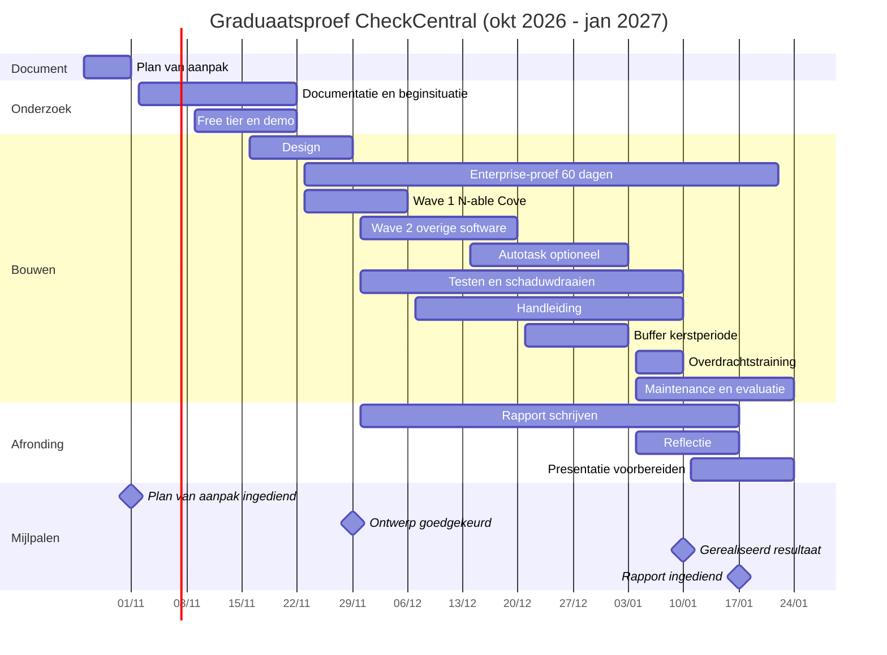

# 2. Plan van aanpak

> Titel: **Geautomatiseerde back-upmonitoring via CheckCentral bij Lipa ICT** (64 tekens)
> Student: Lore Grymonprez · Werkplekcoach: Edwin Vanspauwen · PXL-coach: Klaas Thys
> Versie: 29 oktober 2026 · Deadline: **1 november 2026**
>
> De volledige, ingediende versie staat in het Claude Doc / Blackboard. Dit bestand is de samenvatting voor de repo.
> **Geen klantnamen of hostnamen in deze repo.**

## 2.1 Weken (projectweken)

| Week | Datum | Week | Datum |
|---|---|---|---|
| 6 | 26 okt–1 nov | 13 | 14–20 dec |
| 7 | 2–8 nov | 14 | 21–27 dec |
| 8 | 9–15 nov | 15 | 28 dec–3 jan |
| 9 | 16–22 nov | 16 | 4–10 jan |
| 10 | 23–29 nov | 17 | 11–17 jan |
| 11 | 30 nov–6 dec | 18 | 18–24 jan |
| 12 | 7–13 dec | | |

## 2.2 Fasen volgens de onderzoekscyclus

| Fase | Onderdeel | Periode | Deliverable | Betrokkenen | Onderzoeksmethode |
|---|---|---|---|---|---|
| 1 | Probleemstelling en analyse | t.e.m. wk 6 | Projectvoorstel, plan van aanpak | PXL-coach, werkplekcoach | Analyse bestaande werkwijze |
| 2 | Onderzoeksuitvoering: documentatie, beginsituatie, Free tier, demo | wk 7–9 | Inventaris, mailanalyse, demo-verslag | Support engineers, werkplekcoach, CheckCentral-support | Literatuurstudie, inventarisatie, observatie, interview, vergelijking |
| 3.1 | Design | wk 9–10 | Ontwerpdocument | Werkplekcoach, support engineers | Vergelijking (mail versus directe integratie) |
| 3.2 | Implementatie: Wave 1 (Cove), Wave 2, optioneel Autotask | wk 10–15 | Operationeel dashboard | Support engineers, werkplekcoach | Iteratief per batch |
| 3.3 | Testing en schaduwdraaien | wk 11–16 | Testrapport | Support engineers, werkplekcoach, PXL-coach | Testscenario's, schaduwdraaien |
| 3.4 | Documentatie en overdracht | wk 12–16 | Beheerhandleiding, overdracht | Support engineers, collega-systeembeheerders | Observatie nieuwe gebruiker |
| 3.5 | Maintenance en evaluatie proefperiode | wk 16–18 | Advies over abonnement | Werkplekcoach, verantwoordelijke Lipa ICT | n.v.t. |
| 4 | Rapporteren | wk 11–17 | Eindrapport (17 jan 2027) | PXL-coach, werkplekcoach | n.v.t. |
| 5 | Reflecteren en presentatie | wk 16–18 en daarna | Reflectie, slides, demo | Jury, werkplekcoach, collega's | n.v.t. |

## 2.3 Scope

**Binnen:** enkel klanten met onderhouds- of back-upcontract · uitrol in waves (Wave 1 = N-able Cove, Wave 2 = overige software) · matching rules, schedules (dead man's switch), dashboards, testen, handleiding, overdracht.
**Extra (stretch):** Autotask-koppeling (ticket openen bij Error/Warning/Missing, sluiten bij Success).
**Buiten:** klanten zonder contract, maatwerk webapps, databases, extra servers, zware scripts; software zonder standaardmail (Xcopy, PowerShell/Robocopy, Proxmox, BackupNet2Access) tenzij het onderzoek anders uitwijst.

## 2.4 Gantt-chart

### Mijlpalen

| Mijlpaal | Week | Datum |
|---|---|---|
| Plan van aanpak ingediend | 6 | 1 nov 2026 |
| Beginsituatie en contractklanten bevestigd | 8 | 15 nov 2026 |
| Demo CheckCentral gehouden | 9 | ± 22 nov 2026 |
| Ontwerp goedgekeurd, Enterprise-proef start | 10 | ± 29 nov 2026 |
| Wave 1 live | 11 | ± 6 dec 2026 |
| Wave 2 live | 13 | ± 20 dec 2026 |
| Gerealiseerd resultaat afgerond | 16 | 10 jan 2027 |
| Eindrapport ingediend | 17 | 17 jan 2027 |
| Presentatie klaar, proefperiode eindigt | 18 | ± 22–24 jan 2027 |

## 2.5 Afhankelijkheden, feedback en buffer

- De demo bepaalt of Wave 1 via directe integratie of e-mail loopt; het design start na de demo.
- De Enterprise-proef (60 dagen) start pas na een goedgekeurd ontwerp, zodat ze de uitrol, het rapport en de periode rond de jury dekt.
- Wave 2 start nadat de pilot in Wave 1 loopt.
- Schaduwdraaien duurt minstens twee volledige weken (wk 13–16), zodat wekelijkse jobs twee keer voorkomen.
- Autotask is optioneel en vervalt als de kern vertraagt.
- Feedback: wekelijks met de werkplekcoach; vijf check-ins met de PXL-coach (voorlopig wk 7, 10, 13, 16, 17); validatie door support engineers na elke wave.
- Buffer: wk 14–15 (kerst) zijn buffer en schrijftijd.
- Tijd: max. 4 uur per week op de werkplek (OnStage, *Graduaatsproef*).

## 2.6 Definition of Done

- [ ] Alle back-ups van contractklanten gekoppeld aan een check (via mail of directe integratie)
- [ ] Matching rule en statusmapping per softwaretype
- [ ] Schedules (dead man's switch) per relevante check
- [ ] Scenario's Success, Warning, Error en Missing getest en gedocumenteerd
- [ ] Schaduwdraaien minstens twee weken uitgevoerd
- [ ] Handleiding gevalideerd door minstens twee support engineers
- [ ] Overdracht afgetekend door de werkplekcoach
- [ ] Privacy-conclusie bevestigd door een verantwoordelijke bij Lipa ICT

## 2.7 Risicoregister

| Risico | Impact | Kans | Maatregel |
|---|---|---|---|
| Aantal checks hoger dan ondergrens | Middel | Middel | Mailanalyse in fase 2; kostenraming bijwerken |
| Mailformaat niet te parsen | Middel | Middel | Flexibele rules; unmatched-inbox; vroeg testen in Free tier |
| Software zonder standaardmail | Laag | Hoog | Vroeg in kaart brengen; zonder script buiten scope |
| Onterechte meldingen | Hoog | Laag | Ruime marges in schedules; bijsturen na schaduwdraaien |
| Directe integratie Cove werkt anders dan verwacht | Middel | Laag | E-mailparsing als terugval; keuze in beslissingslog |
| Autotask-koppeling faalt | Laag | Laag | Stretch; mail blijft de basis |
| Proefperiode eindigt vóór de jury (± 22 jan) | Middel | Middel | Tijdig verlenging vragen of betalend abonnement |
| Te weinig werkplektijd | Middel | Middel | Waves, buffer, werk bundelen |
| Klantnamen of hostnamen in repo, rapport of presentatie | Hoog | Laag | Pseudoniemen, geanonimiseerde screenshots, nalezen door werkplekcoach |

## 2.8 Afstemming met de werkplek

- [ ] Planning en fasering besproken met Edwin Vanspauwen
- [ ] Aanpak, waves en scope (enkel contractklanten) haalbaar bevonden
- [ ] Informatie mag gedeeld worden met de externe jury (Lipa ICT mag vermeld worden; klantnamen en hostnamen niet)
- [ ] Privacy-conclusie (laag risico, technische meldingen) bevestigd door een verantwoordelijke bij Lipa ICT

## 2.9 GitHub-milestones

Maak per fase een milestone aan (fase 1, 2, 3.1 … 5) en per deliverable een issue (zie `.github/ISSUE_TEMPLATE/`).
