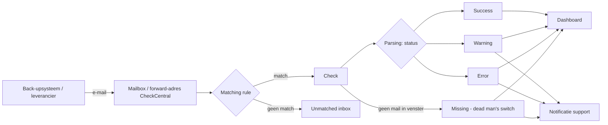

# 4. Ontwerp & matching rules

## 4.1 Conceptueel ontwerp

## 4.2 Naamconventie checks
`<Klant> - <Systeem/Leverancier> - <Jobnaam>` (bv. `Klant-A - Veeam - FileServer nightly`)

## 4.3 Matching-strategie per leverancier
| Leverancier | Match op | Status-parsing | Opmerking |
|---|---|---|---|
| [Leverancier 1] | Afzender + onderwerp bevat "…" | Onderwerp: Success/Warning/Failed | |

Zie ook [`data/matching-rules.csv`](../data/matching-rules.csv) en [`templates/matching-rule.md`](../templates/matching-rule.md).

## 4.4 Statusmapping
| CheckCentral-status | Betekenis | Actie |
|---|---|---|
| Success | Job geslaagd | Geen |
| Warning | Geslaagd met waarschuwing | Opvolgen binnen [X] |
| Error | Job mislukt | Ticket + herstel |
| Missing | Geen mail binnen tijdvenster | Controleer job/mailflow |

## 4.5 Dead man's switch-ontwerp
Per check: verwacht tijdvenster (bv. nachtjobs **01:00–06:00**), tolerantie, escalatie. Zie `data/matching-rules.csv`.

## 4.6 Alertbeleid
Wie ontvangt wat, wanneer, via welk kanaal; onderscheid werkuren/buiten werkuren.

## 4.7 Onderhoudbaarheid
Regels moeten door non-developers aanpasbaar zijn: geen scripts, enkel UI-configuratie + gedocumenteerde conventies.
